<p align="center"></p>

# IFA —— 产线设备上位机框架

> [Taoyl.IFA](https://gitee.com/taoyanl/Taoyl.IFA) · 产线设备上位机框架 · MIT

一套跑在产线工控机上的 WinForms **框架**。它只做产线设备该有的基础能力：PLC 通讯、设备管理与重建、流程状态机、报警、审计、权限、日志、配置中心、数据访问边界、页面骨架与 DI 装配 —— 也就是**每个项目都要重写一遍**的那部分。

**这是框架，不是成品软件。** 仓库里的 13 个页面是这套契约的**参考实现**：它们证明地基真能用（PLC 连得上、数据落得下、流程跑得起来、权限拦得住），不是产品功能清单。真到项目上，工艺流程、产品表结构、画面样式、MES 接口定义，都是你填的。

> 体量作为「不是玩具」的旁证，不是卖点：20 个项目 · 393 个 `.cs` · 约 6.4 万行（手写约 5.2 万）· 19 份模块 README。
>
> 命名：`IFA` = Integrated Factory Automation，`Taoyl.*` 是作者前缀，作为命名空间根保留（.NET 生态惯例，避免与通用名词冲突）。

<p align="center">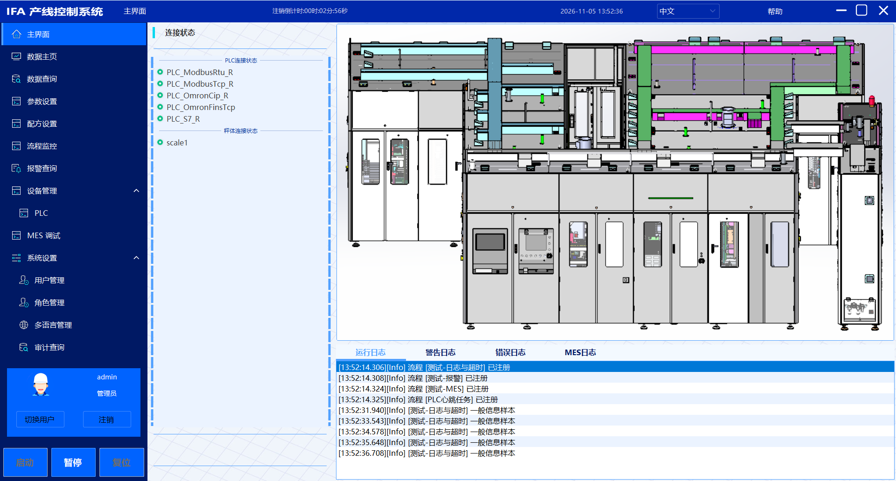</p>

## 边界：框架给什么，你要填什么

这张表是理解本仓库的唯一入口。左边是白送的，右边是留给你的 —— 别指望右边，它真的没有。

| 能力 | 框架已给（直接用） | 项目里要填（框架不管） |
|---|---|---|
| PLC 通讯 | `IPlc` 契约、5 种协议、地址表模型、轮询调度、断线自动重连 | 现场协议参数、地址表内容 |
| 设备管理 | 设备契约 + 运行时 + 配置镜像 + 运行时重建 + 变更通知 | 这个工位有哪几台设备 |
| 流程 | 五态状态机、编排器、故障汇聚、联动暂停、监控门面 | 你的工艺步骤与判定条件 |
| 报警 | 三态分级、写侧队列、弹窗分诊、历史查询与导出 | 报警码表与处置规程 |
| 审计 | 操作留痕 + 字段级旧值/新值 | 要留痕的业务范围 |
| 权限 | 登录、RBAC、菜单/按钮码、启动按 `Menu.json` 同步 | 角色划分与等级 |
| 配置 | 配置中心、判脏/草稿、配方服务骨架 | 你的配置项与配方字段 |
| 数据 | 仓储边界、CodeFirst、多库切换、通用查询/展示页 | 你的表结构与字段 |
| MES | 配置驱动的调用层 + 报文调试页 | `Mes.json` 里的接口定义 |
| UI | 主框架、菜单权限、页面注册、13 个参考页面 | 你的页面长什么样 |
| 日志 | 5 通道、环缓冲上屏、格式与保留期 | 通道划分策略 |
| 多语言 | 三段式 Key、资源扫描、运行时切换 | 译文 |

一句话判据：**换一条产线，左边一行不用改；换一个客户，右边全要重做。** 分不清某个需求该不该进框架时，就拿这句量一下。

## 为什么要有这一层

不是要替代组态软件 —— 组态解决的是「不写代码」，本框架解决的是「不重复造地基」，两条赛道。真正被省掉的是这些：

| 每个项目从零做 | 本框架已经做过 |
|---|---|
| 多品牌 PLC 各写一套驱动，地址语义各不相同 | 统一 `IPlc` 契约，协议差异收敛在策略字典，换协议不改上层 |
| 换台设备就得重启软件 | 运行时改配置 → 重建实例 → 流程当拍感知并重取引用 |
| 流程启停靠一堆 bool 拼，状态迟早对不上 | 单层五态 + 八触发器白名单 + 非法触发器双重拦截 |
| 报警弹个 MessageBox，第二天没人知道发生过 | 三态分级 + 队列落库 + 弹窗分诊 + 历史查询导出 |
| 出问题查不到谁在什么时候改了哪个值 | 头表 + 明细表，旧值/新值逐字段记录 |
| 每接一次 MES 就重写一遍 HTTP 与重试 | 改 `Mes.json` 加一条接口，不写代码 |
| 按钮权限散在代码里一堆 if-else | 菜单即权限，启动按 `Menu.json` 同步进权限表 |

## 扩展指南

这是本框架真正的交付物。下面每条的「动哪几个文件」都是从源码实测出来的，不是示意。

### 扩展成本速查

| 想加什么 | 新增文件 | 改既有文件 | 配置/页面 |
|---|---|---|---|
| 一种 PLC 协议 | 1~2（驱动 + 可选协议访问） | 2 处各 1 行（枚举 + 工厂字典） | 无，`protocol` 串自解释 |
| 一类设备（扫码枪 / 拧紧枪 / 视觉） | 2（工厂 + 适配器） | 0（反射扫描自动注册） | 无 |
| 一个业务流程 | 1（`ProcessBase` 子类） | 1 行（`ProcessRegistry`） | 无 |
| 一个页面 | 1（Form + VM） | 1 行（`RegisterPage`） | `Menu.json` 一个节点 |
| 一张产品表 | 5~6（实体/DTO/仓储/服务/映射） | 3 处（`ProductModule` 2 行 + `InitTables` 1 项） | 无，自动进下拉 |
| 一个 MES 接口 | 0 | 0 | `Mes.json` 一个节点 |

### 1. 加一种 PLC 协议

**前提**：底层 HSL 已支持该协议。HSL 不支持的协议要自己实现 `Transport` —— 那是另一件工作量的事，框架的「可扩展」不包含替你写协议栈。

| 位置 | 动作 |
|---|---|
| `PlcDriver/Contracts/PlcProtocol.cs` | 加枚举成员（**成员名即磁盘 `protocol` 串**） |
| `PlcDriver/Drivers/XxxTcp.cs` | 新建：继承 `PlcRuntime`，静态 `Create` 装配传输层与协议层 |
| `PlcDriver/Protocols/XxxProtocolAccess.cs` | 地址语义与现有协议不同才新建；相同则直接复用（如 Modbus 系） |
| `Business/Devices/Factory/PlcDeviceFactory.cs` | 协议字典加一行 |

```csharp
// ② Drivers/XxxTcp.cs —— 这是装配代码，不是通讯实现
public class XxxTcp : PlcRuntime
{
    private const int DefaultPort = 502;

    public static IPlc Create(PlcConfig plcConfig, IPlcConfigManager configManager)
    {
        // 协议差异参数一律从 ProtocolParams 取，未配置回退默认，配错就抛（由 BuildDevice 事务序兜住）
        // 生产写法见 ModbusTcp.ParseStation：做范围校验并抛 ArgumentException，不静默回落
        var hslPlc = new XxxNet { Station = byte.Parse(plcConfig.GetProtocolParam("Station", "1")) };

        HslTcpTransport.AttachTcpPipe(hslPlc, plcConfig, DefaultPort);   // IP/端口/两个超时/关管策略统一在这
        var transport = new HslTcpTransport(hslPlc);

        var protocolAccess = new ModbusProtocolAccess(transport);        // 地址语义相同就复用
        return new XxxTcp(plcConfig, protocolAccess, configManager);
    }

    private XxxTcp(PlcConfig cfg, IPlcProtocolAccess access, IPlcConfigManager mgr)
        : base(cfg, access, mgr) { }
}

// ④ PlcDeviceFactory 构造里的协议字典，加一行
[PlcProtocol.XxxTcpNet] = cfg => XxxTcp.Create(cfg, _configManager),
```

**验证**：`Devices.json` 加一台 `"protocol": "XxxTcpNet"` 的设备 → 启动 → 设备管理 → PLC 列表可见 → 连接 → 地址表读一个值。写错协议串会在工厂层直接报「不支持的 PLC 协议」，不会静默降级。

### 2. 加一类设备

`DeviceModule` 用反射扫描 `IDeviceFactory` 实现类注册 —— **加设备类型时这个文件一行都不用改**。

```csharp
// Business/Devices/Factory/ScannerDeviceFactory.cs
public class ScannerDeviceFactory : IDeviceFactory
{
    public string DeviceType => DeviceTypes.Scanner;

    public IDevice CreateDevice(string name, object config)
    {
        // config 可能是 JToken（loader 传的是节点），按 PlcDeviceFactory 的做法序列化往返一次再取强类型
        var cfg = config as ScannerConfig
                  ?? JsonConvert.DeserializeObject<ScannerConfig>(JsonConvert.SerializeObject(config));
        return new ScannerDeviceAdapter(name, cfg);
    }

    public bool TryValidateConfig(object config, out string errMsg) { /* 必填项前置校验，供 UI 提示 */ }
}
```

再加一个 `ScannerDeviceAdapter : IDevice`（`Name` / `DeviceType` / `IsConnected` / `Connect` / `Disconnect` / `GetRawDev<T>` / `Dispose`）。

现有的设备类型名录里 `Scanner`（扫码枪）与 `Scale`（秤）已经占好位 —— `DeviceTypes.cs` 有常量、`DeviceConfigSections.All` 有配置节、`Devices.json` 能写节点，**只缺工厂与适配器两个文件**。`Scanner` 目前就是空位，接一支扫码枪正好照上面这段做。

> 约束：工厂类必须落在 `Taoyl.Application.Business` 程序集（扫描锚点是它）。写错程序集 = 编译过、注册静默为零。

### 3. 加一个业务流程

| 位置 | 动作 |
|---|---|
| `Business/Processes/XxxProcess.cs` | 新建：继承 `ProcessBase`，重写 4 个点 |
| `Business/ProcessHosting/ProcessRegistry.cs` | `Init()` 里加一行 `coordinator.Register(scope.Resolve<XxxProcess>());` |
| `ProcessModule` | 不改（`ProcessBase` 子类自动扫描注册，且已带 `ExternallyOwned`） |

```csharp
internal class StationProcess : ProcessBase
{
    private readonly IProcessContext context;

    public StationProcess(IProcessContext context)
    {
        this.context = context ?? throw new ArgumentNullException(nameof(context));
        Category = ProcessCategory.Production;
    }

    public override void InitProcess()          // ① 元信息（每次初始化都会调）
    {
        ProcessName = "工位-A 装配";
        WaitTime = 200;
    }

    protected override ProcessStepResult ExecuteStep(int step, CancellationToken token)   // ② 步序主体
    {
        switch (step)
        {
            case 10:
                var plc = context.DeviceManager.GetDevice("PLC_OmronCip_R")?.GetRawDev<IPlc>();
                if (plc == null) return ProcessStepResult.Stay();

                // 读写失败不抛异常，IsSuccess 才是判据 —— Content 在失败时是默认值，看着像读到了 0
                var r = plc.ReadTag<bool>("就绪", "设备就绪1");
                return r.IsSuccess && r.Content ? ProcessStepResult.Next() : ProcessStepResult.Stay();

            default:
                return ProcessStepResult.Jump(10);
        }
    }

    protected override bool CheckHealth() => true;   // ③ 每拍前置健康检查，false 即触发 E001

    protected override void OnDispose() { }          // ④ 订阅了什么就在这里退订（构造里订阅，成对）
}
```

设备引用有两种合法写法：**每步现取**（上面这种，最简单）或**缓存 + 订阅 `DeviceChanged` 置空 + `OnDispose` 退订**。后者见 `Processes/DeviceTestProcess.cs`，它是全项目唯一的示范写法，抄之前先读它的注释。

### 4. 加一个页面

| 位置 | 动作 |
|---|---|
| `UI.Pages/FormXxx.cs`（+ VM） | 新建页面 |
| `IFALaunch/Modules/FormModule.cs` | 一行 `RegisterPage<Taoyl.UI.Pages.FormXxx>(builder);` |
| `UI.FormMain/config/Menu.json` **和** `<exe>/config/Menu.json` | 各加一个节点（双份真相，都要改） |

```json
{
  "Name": "StationConfig",
  "DisplayName": "工位配置",
  "Description": "工位参数与工艺选择",
  "Class": "FormStationConfig",
  "DllName": "Taoyl.UI.Pages",
  "Icon": "参数设置",
  "Level": 300,
  "SortOrder": 12,
  "Features": [
    { "Code": "Btn:StationConfig_Save", "Name": "保存工位参数", "Level": 500 }
  ]
}
```

`DllName + Class` 拼接即为容器注册名（`RegisterPage` 里用的是 `typeof(T).FullName`），所以类型改名或挪命名空间时不会静默漂移。**权限不用手工插库**：启动时 `PermissionSyncService` 按 `Menu.json` 生成 `Page:StationConfig` 与 `Btn:StationConfig_Save`，`Level` 缺省继承父节点。

### 5. 加一张产品表

| 位置 | 动作 |
|---|---|
| `Product/Models/Entities/XxxEntity.cs` | `[SugarTable]` 实体 |
| `Product/Models/Dtos/XxxDto.cs` | 出库一律 DTO（实体不出仓储层） |
| `Product/Interfaces/IXxxRepository.cs` + `Repository/XxxRepository.cs` | 仓储接口 / 实现 |
| `Product/Interfaces/IXxxService.cs` + `Services/XxxService.cs` | 服务，**同时实现 `IProductDataSource`** |
| `Product/Mapping/XxxMappingRegister.cs` | Mapster 双向登记 |
| `ProductModule` | 两行注册（`.As<IXxxService>().As<IProductDataSource>()`） |
| `Bootstrapper.InitDatabase` | `CodeFirst.InitTables(...)` 参数表里加 `typeof(XxxEntity)` |

页面零改动：数据主页与数据查询页构造注入 `IEnumerable<IProductDataSource>`，新表自动进下拉。

> 最后一个 `InitTables` 是手写清单，漏了表就不会建，且不报错。加实体时别只改 `ProductModule`。

### 6. 加一个 MES 接口

改 `<exe>/config/Mes.json` 加一个 `Apis` 节点，或在「MES 调试」页新建后保存。**零代码**。

字段含义与各 `BodyType` 的正文规则见 [`MesDriver/README.md`](Taoyl.Application.MesDriver/README.md)。发送有独立权限码（`Btn:MesDebug_Send`）—— 保存只改本地，发送真打到生产系统，风险不同级。

## 参考实现（13 个页面）

这些页面是框架能力的**冒烟验证**：每一页对应一套契约跑通的证据。它们同时是全套接口的活文档，所以留在仓库里。**你项目里该删就删，该改就改** —— 它们不是产品交付物。

> 图为演示环境：PLC 由 HSLDemo 起仿真服务端，数据由造数脚本生成（脚本见 `tools/seed-demo.sql`），不含真实产线与客户信息。

<table>
  <tr>
    <td width="50%">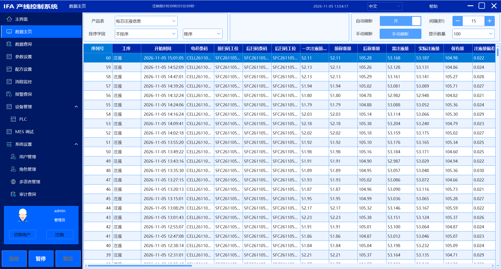<br><b>数据主页</b> · 最新采集数据滚动刷新，可切换产品表、按列排序</td>
    <td width="50%">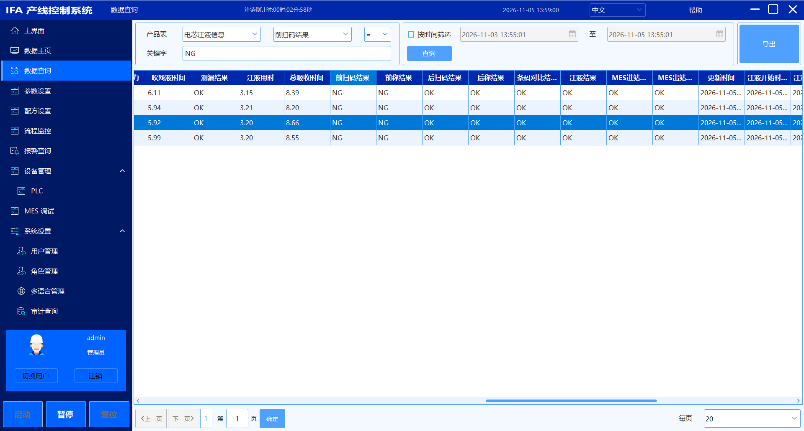<br><b>数据查询</b> · 产品表 / 关键字 / 时间多条件筛选，服务端分页，导出 xlsx</td>
  </tr>
  <tr>
    <td>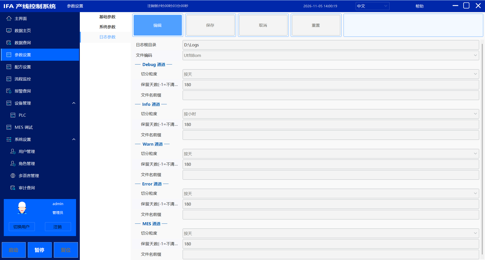<br><b>参数设置</b> · 系统 / 基础 / 日志三类参数，界面由配置模型反射生成</td>
    <td>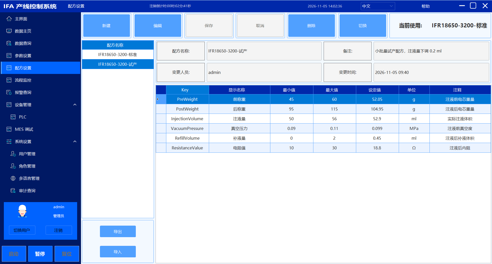<br><b>配方设置</b> · 多配方管理，参数带量程与单位，切换即生效</td>
  </tr>
  <tr>
    <td>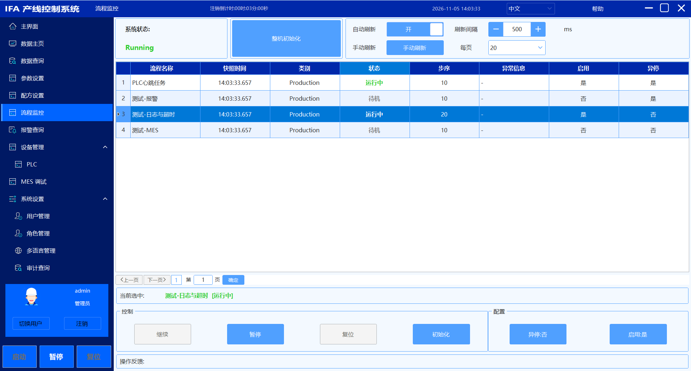<br><b>流程监控</b> · 逐流程状态快照，按钮可用性由状态机的合法触发器派生</td>
    <td>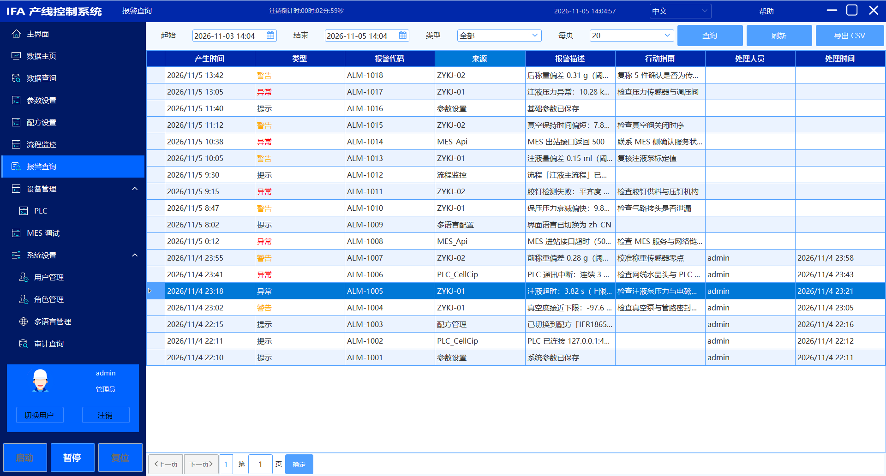<br><b>报警查询</b> · 提示 / 警告 / 异常三态分级，处理人与处理时间可追溯</td>
  </tr>
  <tr>
    <td>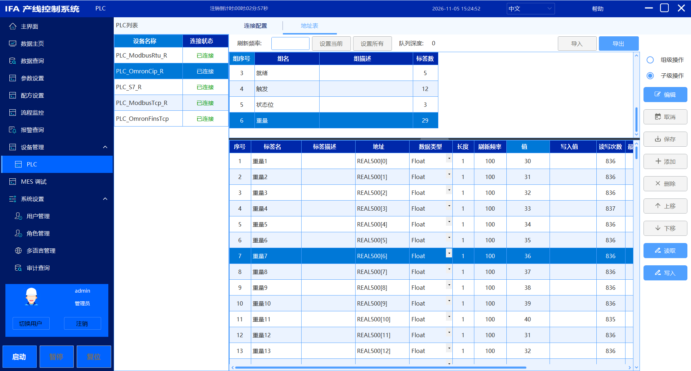<br><b>PLC 调试 · 地址表</b> · 分组管理、运行时导入导出，读写次数与结果逐标签统计</td>
    <td>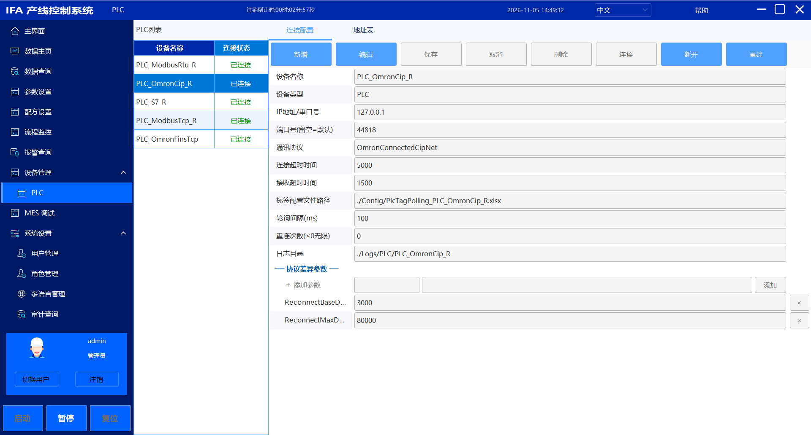<br><b>PLC 调试 · 连接配置</b> · 左侧设备列表 + 右侧连接参数，改完保存并重建实例</td>
  </tr>
</table>

<p align="center">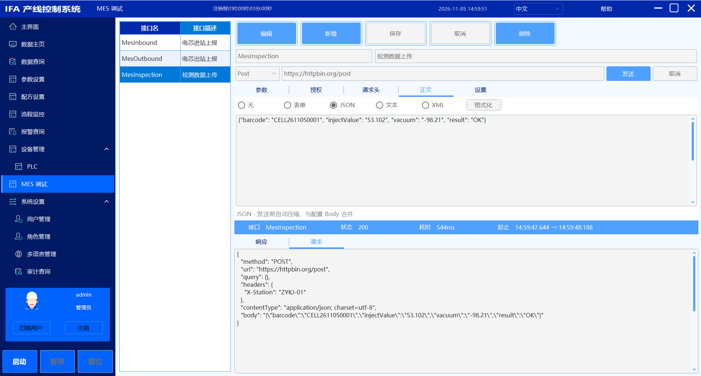<br><b>MES 调试</b> · 接口配置与 JSON 正文编辑，请求与响应报文、状态码、耗时并排</p>

<table>
  <tr>
    <td width="50%">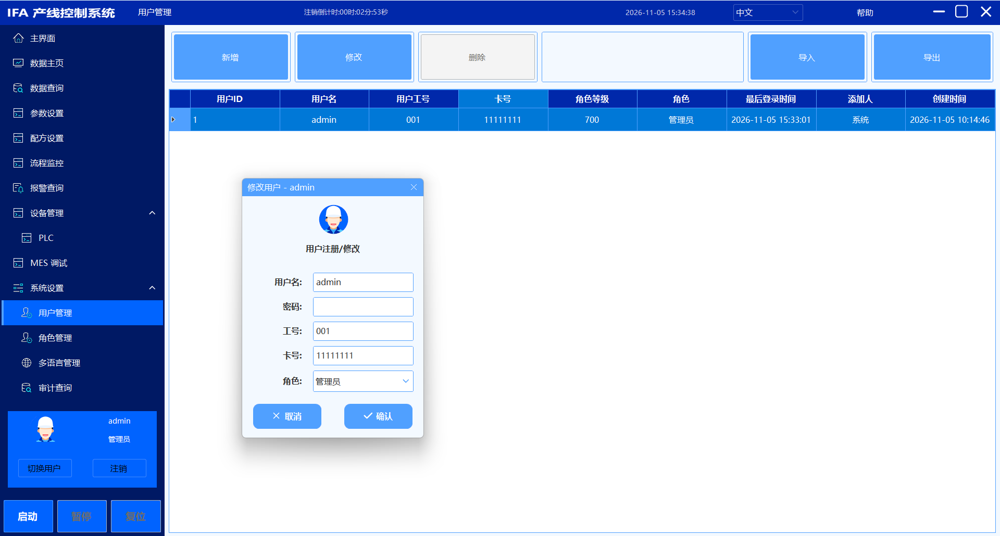<br><b>用户管理</b> · 用户与角色绑定，工号 / 卡号随卡登录</td>
    <td width="50%">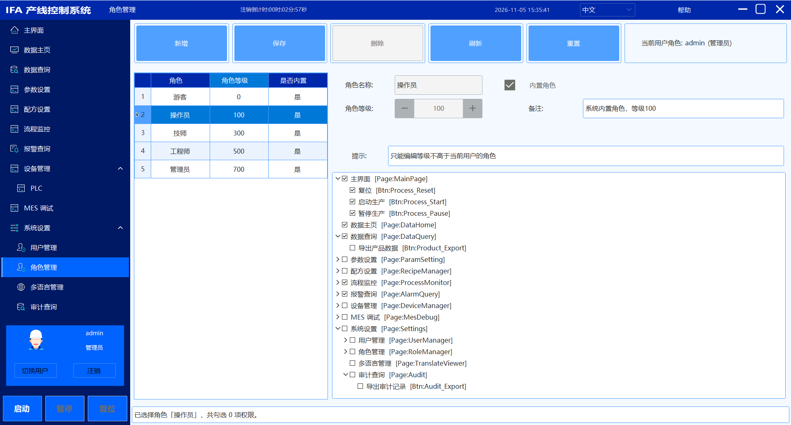<br><b>角色管理</b> · 角色等级 + 权限树，页面码与按钮码分级勾选</td>
  </tr>
  <tr>
    <td>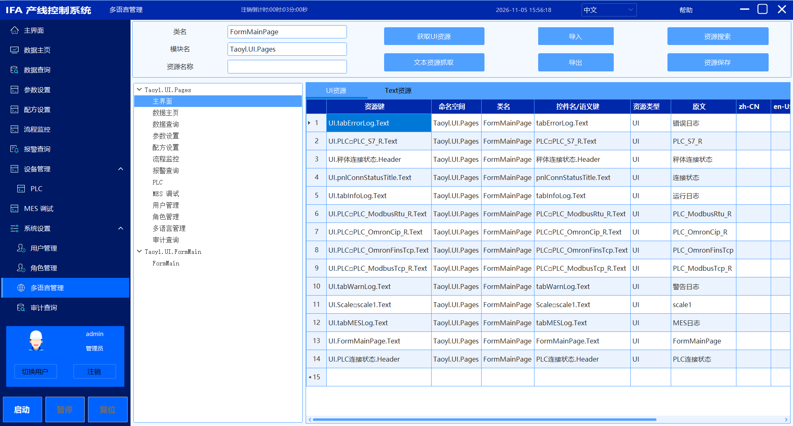<br><b>多语言管理</b> · 扫描界面生成三段式 Key（类.控件.属性），按语言分列维护译文</td>
    <td>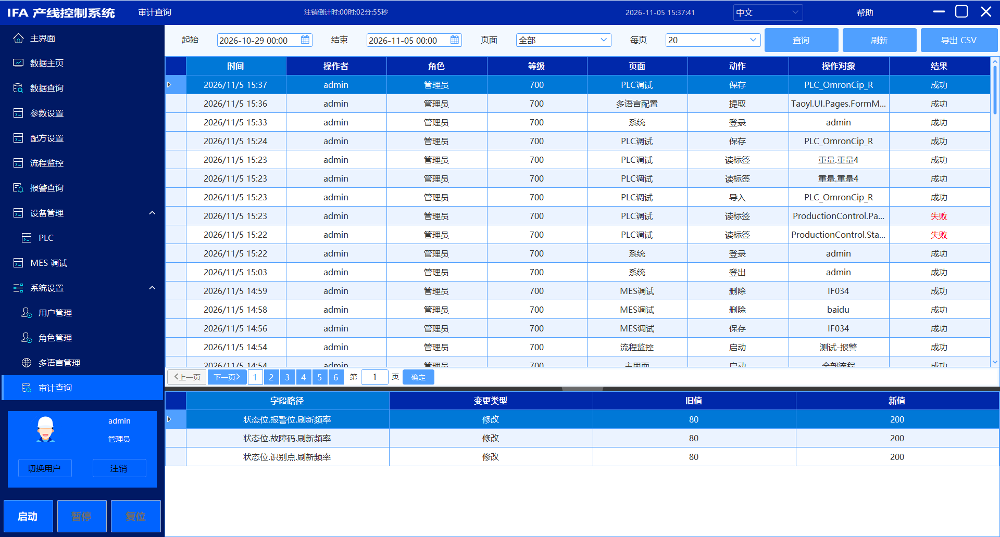<br><b>审计查询</b> · 操作留痕 + 字段级旧值/新值，失败操作同样入库</td>
  </tr>
</table>

## 架构

### 分层与依赖方向

```
        Taoyl.IFALaunch（组合根：唯一 WinExe，只管装配）
                       ↓
   ┌───────────────────┴───────────────────┐
   │                                       │
UI.FormMain（主框架）               UI.Pages（13 个参考页面）
   │        └──────────┬──────────────────┘
   ↓                   ↓
应用层：Business（流程/设备实现）· ProcessMonitoring（监控门面）
        Alarm · Audit · AuthService · Product
                       ↓
   ┌───────────────────┴───────────────────┐
   │                                       │
基座：TaskProcess（流程）  Device（设备契约）
                       ↓
驱动：PlcDriver · MesDriver · LogDriver · TranslateDriver · Communication · Configuration
                       ↓
              DataBase（SqlSugar 唯一出口）
                       ↓
              Share（零依赖契约基座）
```

### 哪些层你会动，哪些别碰

| 层 | 动它的频率 | 说明 |
|---|---|---|
| `Share` / `TaskProcess` / `Device` | 几乎不动 | 契约基座。改这里 = 全项目重编，先想清楚 |
| 驱动层（`PlcDriver` / `MesDriver` / `LogDriver` …） | 加协议、加通道时动 | 以新增为主；改既有逻辑要走一遍它的 README |
| `Business` | 天天动 | 你的流程子类与设备实现在这 |
| `UI.Pages` | 天天动 | 你的页面在这 |
| `IFALaunch`（组合根） | 加模块时动一行 | `Modules/` 一库一文件，装配清单 |

### 依赖铁律

| 规则 | 强制度 |
|---|---|
| `Share` 零项目依赖、零 NuGet | 引任何东西它就失去"公共词汇"资格 |
| `PlcDriver` / `MesDriver` / `Communication` / `FileUtil` 不引同级模块 | 可独立复用 |
| `DataBase` 是唯一认识 SqlSugar 的库 | 服务不摸库，实体可见域仅仓储层 |
| UI 不反向被业务层引用 | 页面通过 `Menu.json` + 容器解析，主窗体不认识任何业务页 |
| 驱动层零 UI 依赖 | 换个界面壳，驱动原样可用 |

这些不是我"设计时的意图"，是 `csproj` 里写的引用关系 —— 越界编译不过。

## 模块索引

19 个模块各有独立 README，含逐文件说明、真实签名表、设计决策与坑位。「扩展位」列告诉你动哪个模块。

| 层 | 模块 | 职责 | 扩展位 | 文档 |
|---|---|---|---|---|
| 组合根 | `Taoyl.IFALaunch` | 容器装配、启动序列、单实例与 DPI | 加模块 / 加页面注册 | [README](Taoyl.IFALaunch/README.md) |
| 基座 | `Share` | 零依赖契约层（认证事实 / 权限码 / 日志策略 / 事件总线） | 极少动 | [README](Taoyl.Application.Share/README.md) |
| 基座 | `TaskProcess` | 流程契约 + 五态状态机 + 编排器 | 极少动 | [README](Taoyl.Application.TaskProcess/README.md) |
| 基座 | `Device` | 设备契约 + 运行时 + 配置设施 | 极少动 | [README](Taoyl.Application.Device/README.md) |
| 驱动 | `PlcDriver` | PLC 通讯：5 协议、IO 引擎、连接状态机 | **加协议** | [README](Taoyl.Application.PlcDriver/README.md) |
| 驱动 | `MesDriver` | 配置驱动的 MES 接口调用层 | 改 `Mes.json` 即可 | [README](Taoyl.Application.MesDriver/README.md) |
| 驱动 | `LogDriver` | NLog 落盘 + 环缓冲 UI + 保留期清理 | 加日志通道 | [README](Taoyl.Application.LogDriver/README.md) |
| 驱动 | `TranslateDriver` | 零依赖翻译引擎 + 反射扩展 | 加翻译器 | [README](Taoyl.Application.TranslateDriver/README.md) |
| 驱动 | `Communication` | Modbus TCP/RTU 主站（NModbus 封装） | 加主站形态 | [README](Taoyl.Application.Communication/README.md) |
| 驱动 | `Configuration` | 配置中心 + 配方服务 + 判脏/草稿机制 | 加配置模型 | [README](Taoyl.Application.Configuration/README.md) |
| 数据 | `DataBase` | SqlSugar 唯一出口、多库切换、SQLite 路径解析 | 加库类型 | [README](Taoyl.Application.DataBase/README.md) |
| 数据 | `FileUtil` | CSV 读写（BOM、追加、DataTable） | — | [README](Taoyl.Application.FileUtil/README.md) |
| 应用 | `Business` | 流程子类 + 设备实现 + 进程内事件总线 | **加流程 / 加设备** | [README](Taoyl.Application.Business/README.md) |
| 应用 | `ProcessMonitoring` | UI ↔ 流程引擎的监控门面 | — | [README](Taoyl.Application.ProcessMonitoring/README.md) |
| 应用 | `Alarm` | 报警三态、写侧队列、弹窗通道策略 | 加弹窗通道 | [README](Taoyl.Application.Alarm/README.md) |
| 应用 | `Audit` | 操作留痕 + 字段级变更 diff | 加留痕范围 | [README](Taoyl.Application.Audit/README.md) |
| 应用 | `AuthService` | 登录 / 会话 / RBAC 权限域 | 加认证方式 | [README](Taoyl.Application.AuthService/README.md) |
| 应用 | `Product` | 产品库：实体 + DTO + 仓储 + 通用查询 | **加产品表** | [README](Taoyl.Application.Product/README.md) |
| 界面 | `UI.FormMain` | 主窗体、菜单权限、导航、配置界面渲染 | 改主框架样式 | [README](Taoyl.UI.FormMain/README.md) |
| 界面 | `UI.Pages` | 13 个参考页面（暂无独立 README） | **加页面** | — |

第一次读代码的顺序：`IFALaunch`（装配与启动序列）→ `Share`（为什么要有契约层）→ 挑一个驱动看（`PlcDriver` 或 `MesDriver`）→ `Audit`（数据访问边界的母本）。只想用不想读，直接跳「扩展指南」。

## 技术栈

| 用途 | 选型 | 版本 | 为什么 |
|---|---|---|---|
| UI 框架 | SunnyUI | 3.9.1 | WinForms 生态里控件覆盖最全，主题统一，省掉自绘成本 |
| 依赖注入 | Autofac | 7.1.0 | 命名注册（`RegisterPage<T>`）+ 模块化注册，天然适配 `DllName.Class` 页面解析 |
| MVVM | CommunityToolkit.Mvvm | 8.2.2 | 源生成器免手写 `INotifyPropertyChanged`，C# 7.3 下也能用 |
| ORM | SqlSugar | 5.1.4.207 | CodeFirst 建表 + 多库切换 + 表达式树查询，切换 SQLite 零代码改动 |
| PLC 通讯 | HslCommunication | 12.5.3 | 覆盖欧姆龙 / 西门子 / Modbus，支持仿真服务端（无硬件可调试） |
| Modbus | NModbus | 3.0.83 | 独立的 Modbus 主站实现，与 HSL 并行的第二条通讯线 |
| 状态机 | Stateless | 5.20.1 | 流程五态 + 触发器白名单，规则集中一处 |
| 日志 | NLog | 6.0.6 | 异步写入 + CSV 布局 + 按文件大小/日期归档 |
| 对象映射 | Mapster | 10.0.13 | 实体 ↔ DTO 显式双向登记，漏登编译期报错 |
| Excel | MiniExcel | 1.42.0 | 地址表导入导出，比 EPPlus 轻 |
| CSV | CsvHelper | 33.1.0 | 引号内逗号/换行正确处理 |
| JSON | Newtonsoft.Json | 13.0.4 | 配置序列化 + `PopulateObject` 原地填充 |

## 快速开始

### 环境要求

- Windows 10 / 11
- Visual Studio 2022（含 .NET Framework 4.7.2 开发工具）
- 无需数据库服务器（默认 SQLite，首次运行自动建库建表）

### 运行

```bash
git clone https://gitee.com/taoyanl/Taoyl.IFA.git
```

1. 用 VS 打开 `Taoyl.IFA.sln`
2. 设 `Taoyl.IFALaunch` 为启动项目，F5
3. 首次启动自动完成：`config/` 配置模板拷贝 → SQLite 建库 → CodeFirst 建 9 张表 → 内置管理员创建
4. 登录：**admin / 111**（内置管理员，首次登录后请改密码）

配置与数据落在 `<exe目录>` 下：

```
bin/Debug/net472/
├─ config/            ← 配置文件（首次构建从模板拷贝，之后不再覆盖）
├─ Data/tyl_ifa.db    ← SQLite 库（CodeFirst 自动创建）
└─ Logs/              ← 运行日志
```

### 跑起来应该看到什么

| 检查点 | 正常表现 | 不对时查哪里 |
|---|---|---|
| 菜单树 | 左侧出现 10 个顶层节点（主界面 / 数据主页 / 数据查询 / 参数设置 / 配方 / 流程监控 / 报警查询 / 设备管理 / MES 调试 / 系统设置） | 角色等级不够 → 换 `admin` 登录 |
| 数据库 | `Data/tyl_ifa.db` 已生成且大小 > 0 | CodeFirst 失败 → 看 `Logs/` 的 Error 通道 |
| 日志栏 | 主界面底部有启动期 INFO 日志 | 空白 → `config/LogConfig.json` 的 `RootPath` 是否可写 |
| 设备状态 | 没起仿真服务端时显示「未连接」——**这是正常的** | 显示已连接但读不到值 → 核对协议与地址表 |
| MES 接口 | 空列表（`config/Mes.json` 首次不存在）——**这也是正常的** | 想看到示例 → 从旧版本的 `config/Mes.json` 抄一份，或在页面上新建后保存 |

### 没有 PLC 硬件怎么跑

用 HSLCommunication 自带的 **HSL 测试工具**（第三方工具，非本项目组件）起虚拟 PLC 服务端，端口与 `config/Devices.json` 的示例设备一一对齐：

| 协议 | 本框架设备名 | 协议类型 | 端口 | 仿真服务端 |
|---|---|---|---|---|
| 欧姆龙 CIP | `PLC_OmronCip_R` | `OmronConnectedCipNet` | 44818 | `OmronCipServer` |
| 欧姆龙 FINS | `PLC_OmronFinsTcp` | `OmronFinsTcpNet` | 9600 | `OmronFinsServer` |
| 西门子 S7 | `PLC_S7_R` | `SiemensS7Net` | 102 | `SiemensS7Server` |
| Modbus TCP | `PLC_ModbusTcp_R` | `ModbusTcpNet` | 502 | `ModbusTcpServer` |
| Modbus RTU | `PLC_ModbusRtu_R` | `ModbusRtu` | COM6 | 需虚拟串口对（com0com 等），起串口服务端 |

**本框架侧**：两边只认 `protocol` / `ip` / `port` 三件事，`config/Devices.json` 对齐即可。以下是仓库内现成的两条（节选，完整字段见该文件）：

```json
{ "name": "PLC_OmronCip_R",   "protocol": "OmronConnectedCipNet", "ip": "127.0.0.1", "port": "44818",
  "plctagsPath": "./config/PlcTagPolling_PLC_OmronCip_R.xlsx", "pollingTime": "20" },
{ "name": "PLC_OmronFinsTcp", "protocol": "OmronFinsTcpNet", "ip": "127.0.0.1", "port": "9600",
  "plctagsPath": "./config/PlcTagPolling_PLC_OmronFinsTcp.xlsx",
  "protocolParams": { "PLCType": "CSCJ", "DataFormat": "CDAB" } }
```

`protocol` 的取值就是协议策略名，写错会在设备工厂层直接报「协议不支持」；串口设备的 `ip` 填 COM 号、`port` 留空，其余参数进 `protocolParams`。

界面等价操作：**设备管理 → PLC**，逐台改协议 / IP / 端口 → 保存 → 点「重建」让实例按新配置重连（设备列表与参数表单见「参考实现 → PLC 调试」）。

四种网络协议各有一份现成服务端，点「启动服务」后从本框架连上去即可；地址表里写一个值，PLC 调试页就能读到，整条链路贯通。

<table>
  <tr>
    <td width="50%">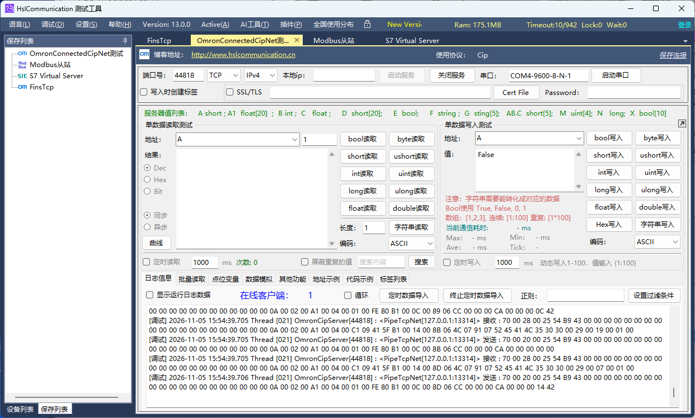<br><b>欧姆龙 CIP</b> · 端口 44818，在线客户端 = 已连上的实例数</td>
    <td width="50%">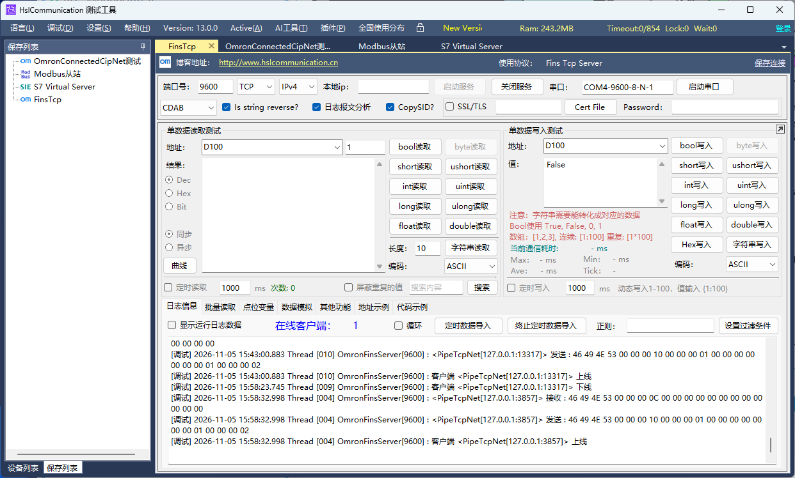<br><b>欧姆龙 FINS</b> · 端口 9600，地址 D100 起为数据区</td>
  </tr>
  <tr>
    <td>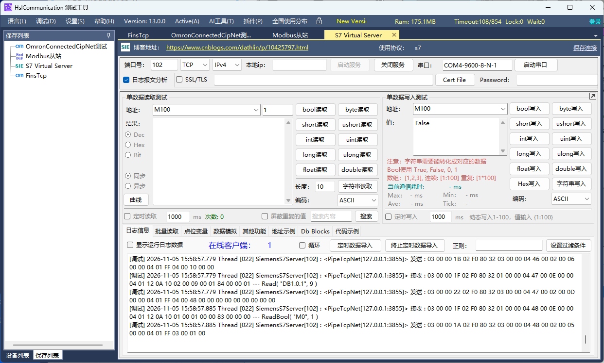<br><b>西门子 S7</b> · 端口 102，M100 / DB1 可读写</td>
    <td>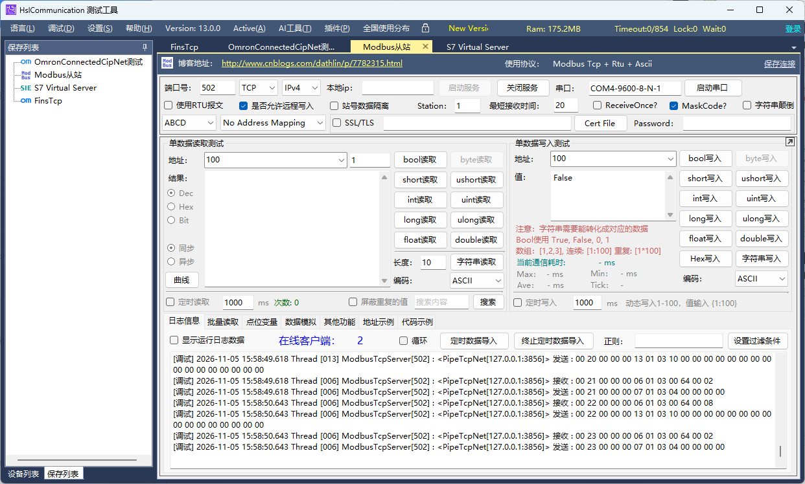<br><b>Modbus TCP</b> · 端口 502，站号 1</td>
  </tr>
</table>

> 上图为 HSLCommunication 官方测试工具的界面，本项目只把它当仿真数据源，不随仓库分发。
> 图中工具版本（13.x）高于项目引用的 `HslCommunication 12.5.3`，不影响使用——仿真端只按协议回包，与客户端库版本无关。

### 下一步：把它变成你的项目

跑通之后不要停在"能看见界面"。按这个顺序走一遍，框架的用法就全懂了：

1. **删**：把 `UI.Pages` 里用不上的参考页面删掉，`Menu.json` 对应节点一并删（权限下次启动自动失效）
2. **加流程**：照「扩展指南 3」写一个只打印日志的空流程，起来能在流程监控页看到它待命 —— 这一步验证的是注册链路
3. **加页面**：照「扩展指南 4」加一个空页面，验证菜单、权限、容器解析三件事同时通了
4. **接设备**：`config/Devices.json` 改成现场设备，地址表导成 Excel，PLC 调试页读写通过
5. **填工艺**：把第 2 步的空流程填成真流程

走到第 5 步，这个仓库就不再是框架，而是你的项目了。

## 工程实践

| 项 | 做法 |
|---|---|
| 提交规范 | `type(scope): 中文描述`，一次提交一个主题，`add` 显式列文件 |
| 编码规范 | `.cs`/`.csproj` = UTF-8 BOM + LF；`.md`/`.json` = 无 BOM + LF（`.gitattributes` 强制） |
| 注释标准 | 只在「反直觉 / 易踩坑 / 有代价」处写，不解释代码在做什么 |
| 文档标准 | 模块 README 统一 10 节骨架：定位 → 依赖 → API → 快速开始 → 示例 → 结构 → 内部逻辑 → 注意 → 扩展 → 相关文档 |
| 数据访问边界 | 实体可见域仅仓储层 + 服务方法栈；服务接口 / 总线 / 流程 / UI 一律 DTO |
| 配置双份 | `Taoyl.UI.FormMain/config/` 是模板，`<exe>/config/` 是运行时。拷贝由 `Taoyl.IFALaunch.csproj` 的 MSBuild Target 逐文件执行「输出目录不存在才拷」，保护现场修改；**新增配置文件要同时在那个 Target 里加一行 Copy** |
| 页面契约 | `Menu.json` 的 `DllName + Class` ↔ Autofac Named 名（`typeof(T).FullName`），启动自检预检缺失页面 |
| 手写登记点 | 协议（`PlcDeviceFactory`）、流程（`ProcessRegistry`）、页面（`FormModule`）、产品表（`ProductModule` + `InitTables`）四处是人工清单，加东西时逐个确认 |

## 边界与欠账

两件事得分清楚：**有意不做**的和**还没做**的。

### 框架有意不覆盖（设计取舍，别来要）

| 项 | 为什么 |
|---|---|
| 具体工艺流程与判定 | 五态引擎与编排给你，工艺是项目的核心资产，不该躺在框架里 |
| 画面样式与 HMI 布局 | 只给主框架与页面骨架，产线画面因客户而异 |
| 报表 / 看板 / 大屏 | 数据已结构化落库，报表按需接 BI 或自绘 |
| 多机协同 / 服务端 | 当前形态是单机，配置与库都在本机；要 C/S 或集中管理是另一个设计 |
| 密码加密 | 当前明文（审计表有脱敏，用户表没有）。上加密需考虑导出包兼容 |
| PLC 协议栈本身 | 通讯底座是 HSL，框架做的是契约、调度与状态机，不重写协议 |
| 跨平台 | WinForms + .NET Framework 4.7.2 冻结，无迁移计划 |

### 当前欠账（欢迎 PR）

| 项 | 说明 |
|---|---|
| 无自动化测试 | 单人项目取舍：靠分层隔离 + 编译期约束控风险，测试待补 |
| `UI.Pages` 无页面级 README | 13 个页面代码自解释，但页面级说明缺失 |
| `Scanner` 无工厂实现 | 类型常量、配置节、`Devices.json` 节点都已就位，只缺工厂与适配器两个文件 |
| `Communication` RTU 主站未接入 | 已实现未挂到设备工厂，当前走的是 `PlcDriver` 的 Modbus RTU |
| 登记点仍是手写清单 | 协议 / 流程 / 页面 / 产品表四处靠人记，可扫描化但尚未做 |
| HSL 免费版通讯时长 | 这个限制来自**通讯库、不是本框架**：HslCommunication 官方标注免费版「可免费运行 24 小时」仅作功能性验证，官方 API 文档载明激活失败时「24 小时后所有的网络通信不会成功」。本项目未调用授权接口，未购买授权时长时间连续运行会出现**通讯中断**（框架、流程与业务逻辑不受影响） |

## License

[MIT](LICENSE)

---

**技术问题**：欢迎提 Issue。**仓库**：[gitee.com/taoyanl/Taoyl.IFA](https://gitee.com/taoyanl/Taoyl.IFA)
